# Tuckfill Guide

[English](README.md) · **Bahasa Indonesia**

Tuckfill adalah Chrome extension untuk teks yang sering kamu ketik di form: email test, password, alamat, template. Simpan sekali, lalu isi field mana pun lewat tombol kecil di dalam field-nya. Semua data tersimpan **terenkripsi di laptop kamu sendiri** dan nggak dikirim ke mana pun.

> Panduan ini juga ada di dalam zip Tuckfill sebagai `PANDUAN.html`. Bisa dibuka offline dan di-print ke PDF.

> 📖 Lebih enak dibaca per halaman? Buka **[Wiki](https://github.com/rmaw22/tuckfill-docs/wiki/Home-(ID))**.

**Contents:** [1. Install](#1-install) · [2. Getting started](#2-getting-started) · [3. Turn on for a site](#3-turn-on-for-a-site) · [4. Fill a field](#4-fill-a-field) · [5. Sets](#5-sets-fill-several-fields-at-once) · [6. Touch ID, auto-lock & backup](#6-touch-id-auto-lock--backup) · [7. Report a bug](#7-report-a-bug) · [Limits & FAQ](#limits--faq)

---

## 1. Install

1. Unzip `tuckfill-<versi>.zip` ke folder yang **tetap**, misalnya `Documents/Tuckfill`. Jangan dihapus atau dipindah, karena Chrome menjalankan Tuckfill dari folder itu.
2. Buka `chrome://extensions`, lalu nyalakan **Developer mode** di pojok kanan atas.
3. Klik **Load unpacked**, lalu pilih folder tadi (yang berisi `manifest.json` dan `PANDUAN.html`).
4. Klik ikon puzzle di toolbar Chrome, lalu pin **Tuckfill** supaya selalu kelihatan.

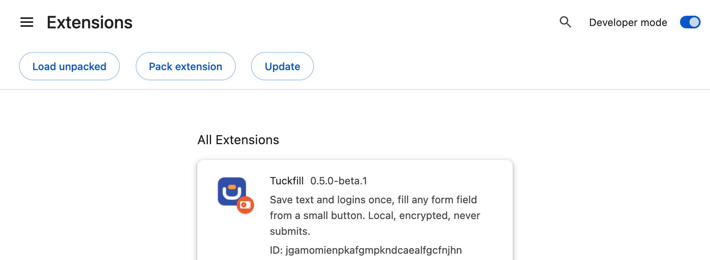

> **Update ke versi baru:** timpa isi folder yang **sama** dengan isi zip baru, lalu klik ikon reload di card Tuckfill di `chrome://extensions`. Data kamu tetap aman.

## 2. Getting started

### Create a passphrase

Klik ikon Tuckfill, lalu buat **passphrase** minimal 10 karakter. Passphrase ini yang mengunci semua entry kamu.

> [!WARNING]
> **Ingat baik-baik.** Kalau lupa, data nggak bisa dipulihkan, oleh siapa pun.

Passphrase cukup dimasukkan sekali per browser session. Setelah itu kamu bisa pakai Touch ID (lihat [section 6](#6-touch-id-auto-lock--backup)).

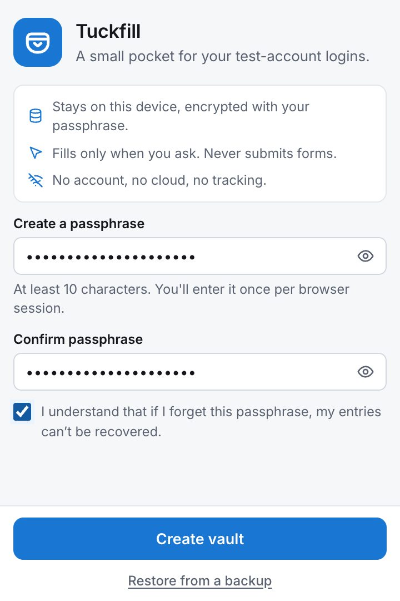

### Add your first entry

Klik **Add** di checklist **Get started**, isi **Name** dan **Value**, lalu klik **Add entry**.

- **Secret**: untuk password atau token. Di-mask (••••), nggak bisa di-search, dan nggak bisa di-copy.
- **Only on this site**: entry cuma muncul di site yang sedang dibuka. Matikan kalau mau muncul di semua site.
- **Group**: opsional, buat mengelompokkan, misalnya "Staging ACME".

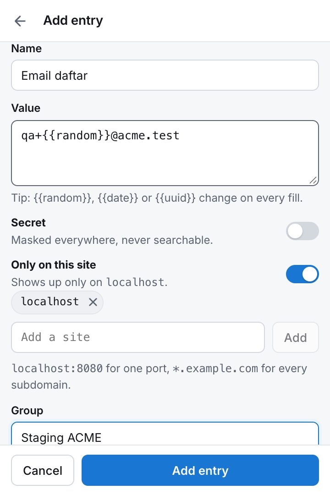

**Dynamic values.** Tulis kode ini di dalam value, dan Tuckfill akan menggantinya setiap kali fill:

| Tulis | Jadi |
|---|---|
| `{{random}}` | 6 angka random, misalnya 481920 |
| `{{date}}` | tanggal hari ini, misalnya 2026-11-06 |
| `{{time}}` | jam, misalnya 14:05 |
| `{{uuid}}` | ID unik yang panjang |

Contoh di screenshot: `qa+{{random}}@acme.test` menghasilkan email baru setiap kali sign up.

## 3. Turn on for a site

Tuckfill cuma aktif di site yang kamu pilih sendiri.

1. Buka site yang mau di-fill.
2. Klik ikon Tuckfill, lalu nyalakan switch di bagian atas (**Show the in-field button here**).
3. Chrome akan minta izin untuk **site itu saja**. Klik **Allow**.

Untuk mematikannya, matikan lagi switch yang sama. Semua site yang sudah on ada di Settings → **Sites**.

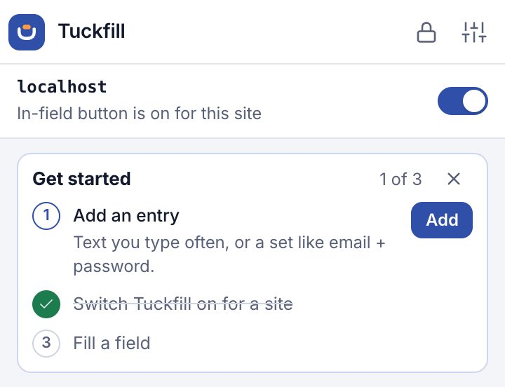

## 4. Fill a field

1. Klik field di site itu. Tombol biru kecil muncul di dalam field.
2. Klik tombolnya, lalu pilih entry. Bisa juga ketik untuk search, lalu tekan <kbd>Enter</kbd>.
3. Value-nya masuk ke field. Tuckfill **nggak pernah** submit form, jadi kamu tetap bisa cek dulu. Salah pilih? Klik **Undo**.

| ① Tombol di dalam field | ② Pilih entry | ③ Terisi, dengan angka random baru |
|---|---|---|
| 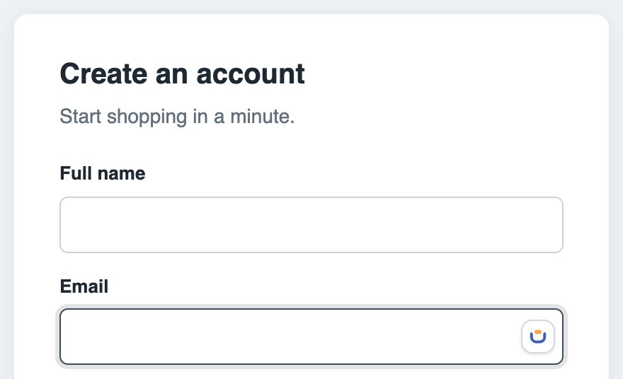 | 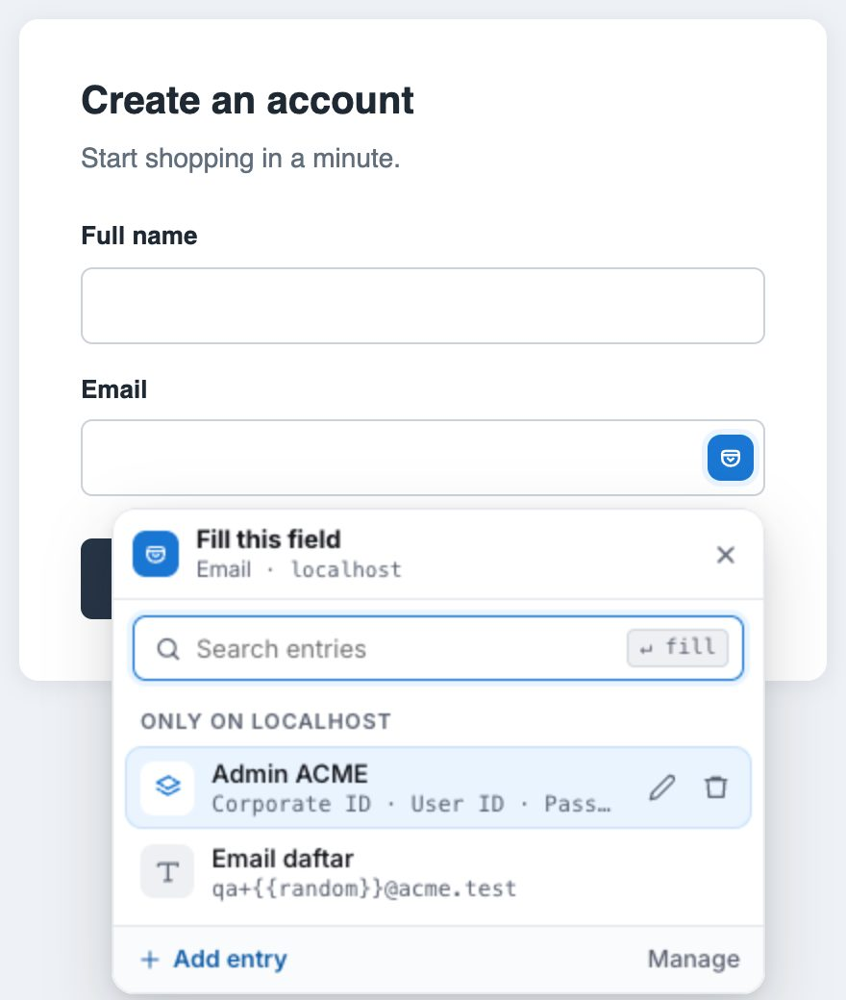 | 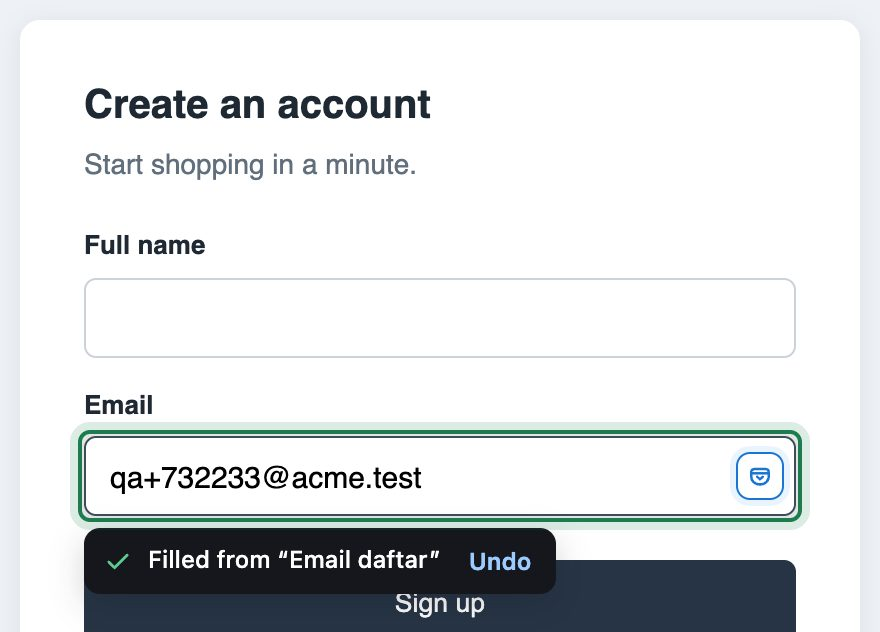 |

Keyboard shortcut: klik field, lalu tekan <kbd>Alt</kbd>+<kbd>Shift</kbd>+<kbd>F</kbd> (Mac: <kbd>⌥ Option</kbd>+<kbd>Shift</kbd>+<kbd>F</kbd>). Di picker, pakai <kbd>↑</kbd> <kbd>↓</kbd> dan <kbd>Enter</kbd>, lalu <kbd>Esc</kbd> untuk menutup.

## 5. Sets: fill several fields at once

Untuk akun test yang terdiri dari beberapa value, misalnya Corporate ID + User ID + Password, buat satu **set**:

1. Klik **Add entry**, lalu pilih **Set of fields**.
2. Kasih nama tiap field **mirip label di form-nya** ("Email", "User ID", "No. HP", "Kata sandi"), lalu isi value-nya.
3. Tandai password sebagai **Secret**.

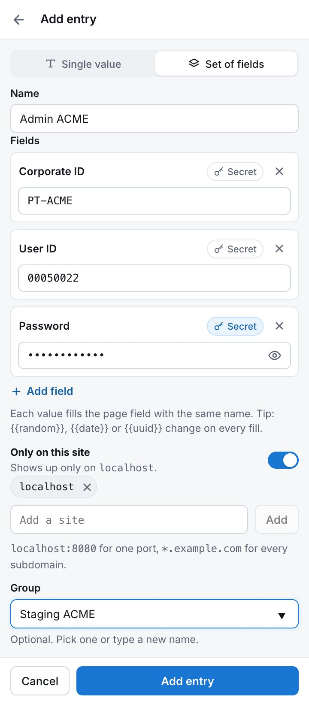

Klik field **mana saja** di form itu, lalu pilih set-nya. Tiap value akan masuk ke field yang namanya cocok.

| Klik field mana saja, pilih set-nya | Tiga field terisi sekaligus |
|---|---|
| 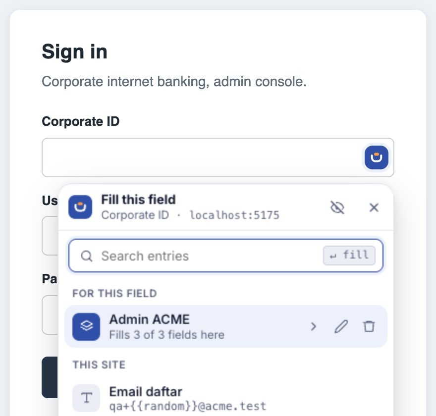 | 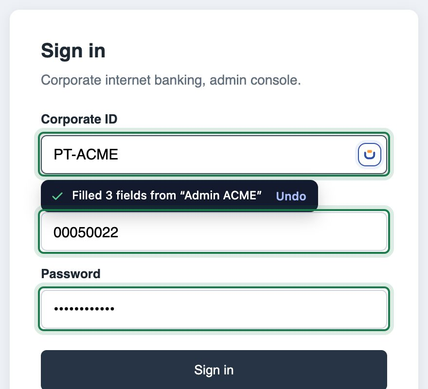 |

- Value yang nggak ketemu pasangan field-nya akan **di-skip**, nggak ditebak. Toast-nya akan kasih tahu, misalnya "Filled 2 of 3, 1 not found".
- Password cuma diisi ke field password.
- Satu klik **Undo** mengembalikan semua field.
- Dalam satu set, semua `{{random}}` pakai angka yang sama.

## 6. Touch ID, auto-lock & backup

Semuanya ada di **Settings** (ikon slider di kanan atas popup).

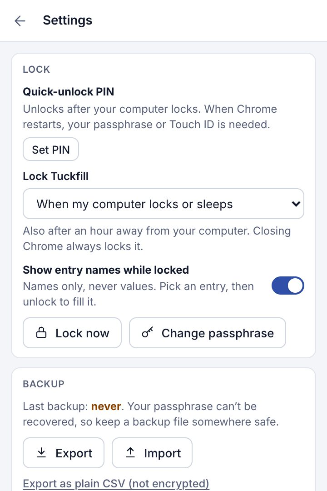

**Touch ID / Windows Hello.** Buka Settings → Lock → **Unlock with Touch ID**, atau terima tawarannya setelah kamu memasukkan passphrase. Simpan passkey-nya ke **iCloud Keychain** atau **Google Password Manager**, jangan ke "This Chrome profile". Passphrase tetap diminta tiap 2 minggu supaya nggak lupa. Di dalam halaman web, Touch ID cuma jalan di site https.

**Auto-lock.** Tuckfill otomatis ke-lock kalau nggak dipakai (default 15 menit) dan saat Chrome ditutup.

**Backup.**
- **Export** menyimpan file `.tuckfill` yang terenkripsi, dibuka dengan passphrase yang sama. Lakukan rutin, karena ini satu-satunya cadangan kalau laptop rusak atau passphrase lupa.
- **Import** menggabungkan file `.tuckfill` atau `.csv` tanpa menghapus entry yang sudah ada.
- Di laptop baru, pilih **Restore from a backup** waktu setup.
- Ada juga export ke CSV biasa, tapi file itu **nggak terenkripsi**.

## 7. Report a bug

1. Buka Settings, scroll ke **About**, lalu klik **Copy**. Ini meng-copy versi Tuckfill, versi Chrome, dan OS, **tanpa** entry atau site kamu.
2. Kirim lewat chat, atau buka **Issue** di repo ini, dengan format:

| | |
|---|---|
| **Details** | hasil Copy dari About |
| **Site** | alamat halaman form-nya |
| **Steps** | apa yang kamu lakukan |
| **Expected** | apa yang seharusnya terjadi |
| **Actual** | apa yang terjadi |
| **Screenshot** | form-nya, kalau masalahnya soal fill |

> [!CAUTION]
> Jangan kirim password, isi entry, atau screenshot popup yang menampilkan isi entry.

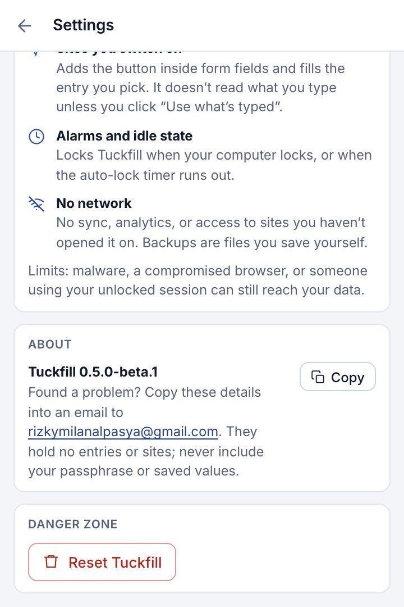

## Limits & FAQ

- Maksimal **1.000 entry** (sekitar 3 MB). Satu value maksimal 5.000 karakter, nama entry 60 karakter, dan 2–12 field per set. File import maksimal 5 MB.
- Belum bisa mengisi dropdown, checkbox, radio button, atau field di dalam iframe dari site lain.
- Value yang di-fill pasti terlihat oleh site itu (memang itu tujuannya), jadi fill hanya di site yang kamu percaya.

**Tombol nggak muncul di field?**
Pastikan site switch di popup sudah on. Tuckfill cuma jalan di halaman http/https biasa, nggak jalan di halaman `chrome://` atau Chrome Web Store.

**Entry hilang setelah update?**
Harusnya nggak, karena Tuckfill punya ID yang tetap di folder mana pun. Pastikan versi lama sudah di-*remove* (jangan sampai ada dua Tuckfill terpasang), lalu buka popup lagi. Kalau masih kosong, restore dari backup dan laporkan.

**Lupa passphrase?**
Nggak bisa dipulihkan. Pilih "Forgot passphrase?" untuk reset (semua entry terhapus), lalu restore dari backup kalau punya.

---

Screenshot memakai demo site dan data palsu, diambil otomatis dari build Tuckfill (`npm run guide:shots` di repo kode).
