<h1 align="center">
  <picture>
    <source media="(prefers-color-scheme: dark)" srcset="images/logo-dark.png">
    
  </picture>
</h1>

  <b>Type it once. Use it constantly. Keep it safe.</b> 
  Saves the text you keep typing into forms and fills it from a small button inside the field.

  
  
  
  
  

  <b>English</b> · <a href="README.id.md">Bahasa Indonesia</a> · <a href="https://github.com/rmaw22/tuckfill-docs/wiki">Wiki</a>

  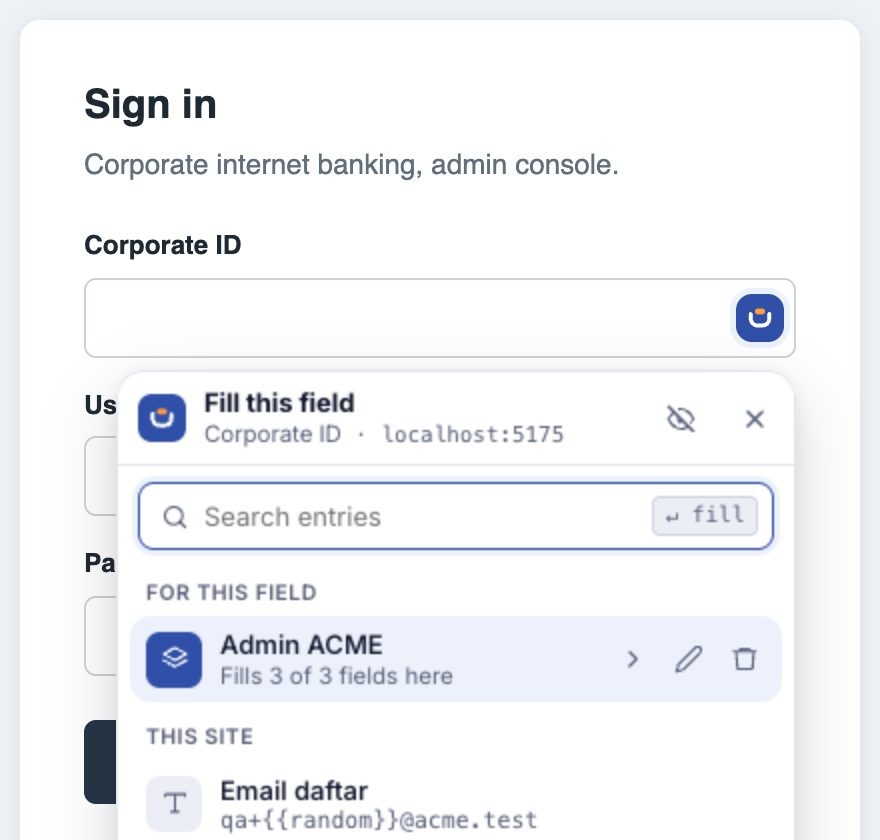

Tuckfill is a Chrome extension for the text you keep typing into forms: test emails, passwords, addresses, templates. Save it once, then fill any field from a small button inside it. Everything is stored **encrypted on your own computer** and never sent anywhere.

> This guide also ships inside the Tuckfill zip as `PANDUAN.html` (Indonesian). It opens offline and prints to PDF.

**Contents:** [1. Install](#1-install) · [2. Getting started](#2-getting-started) · [3. Turn on for a site](#3-turn-on-for-a-site) · [4. Fill a field](#4-fill-a-field) · [5. Sets](#5-sets-fill-several-fields-at-once) · [6. Touch ID, auto-lock & backup](#6-touch-id-auto-lock--backup) · [7. Report a bug](#7-report-a-bug) · [Limits & FAQ](#limits--faq)

---

## 1. Install

1. Unzip `tuckfill-<version>.zip` into a folder that **stays put**, e.g. `Documents/Tuckfill`. Don't delete or move it: Chrome runs Tuckfill from that folder.
2. Open `chrome://extensions` and turn on **Developer mode** (top right).
3. Click **Load unpacked** and pick that folder (the one with `manifest.json` and `PANDUAN.html`).
4. Click the puzzle icon in Chrome's toolbar and pin **Tuckfill** so it's always visible.

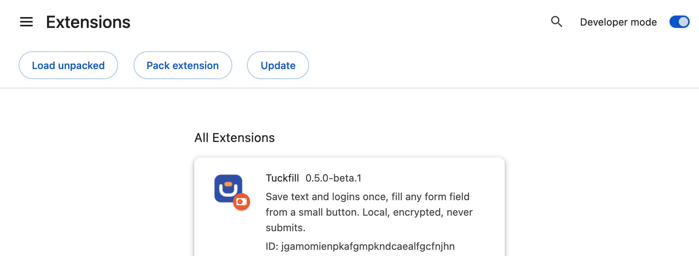

> **Updating:** replace the contents of the **same** folder with the new zip, then click the reload icon on the Tuckfill card in `chrome://extensions`. Your data stays.

## 2. Getting started

### Create a passphrase

Click the Tuckfill icon and create a **passphrase** of at least 10 characters. It locks all your entries.

> [!WARNING]
> **Remember it.** If you forget it, your data can't be recovered by anyone.

You enter it once per browser session. After that you can use Touch ID (see [section 6](#6-touch-id-auto-lock--backup)).

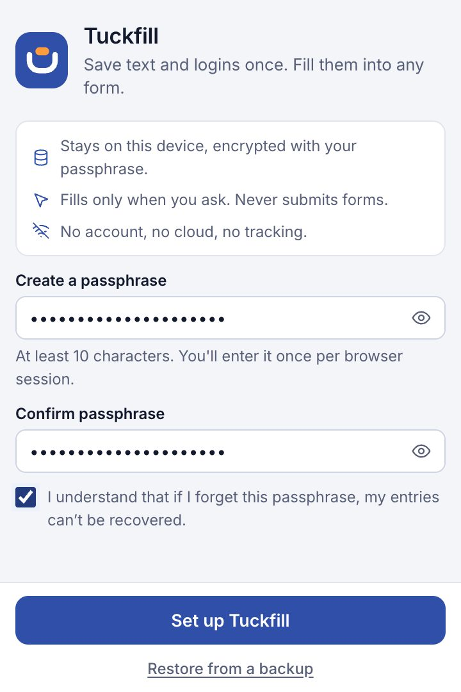

### Add your first entry

Click **Add** in the **Get started** checklist, fill in **Name** and **Value**, then click **Add entry**.

- **Secret**: for passwords and tokens. Masked (••••), not searchable, and can't be copied.
- **Only on this site**: the entry shows up only on the site you have open. Turn it off to show it everywhere.
- **Group**: optional, to keep things together, e.g. "Staging ACME".

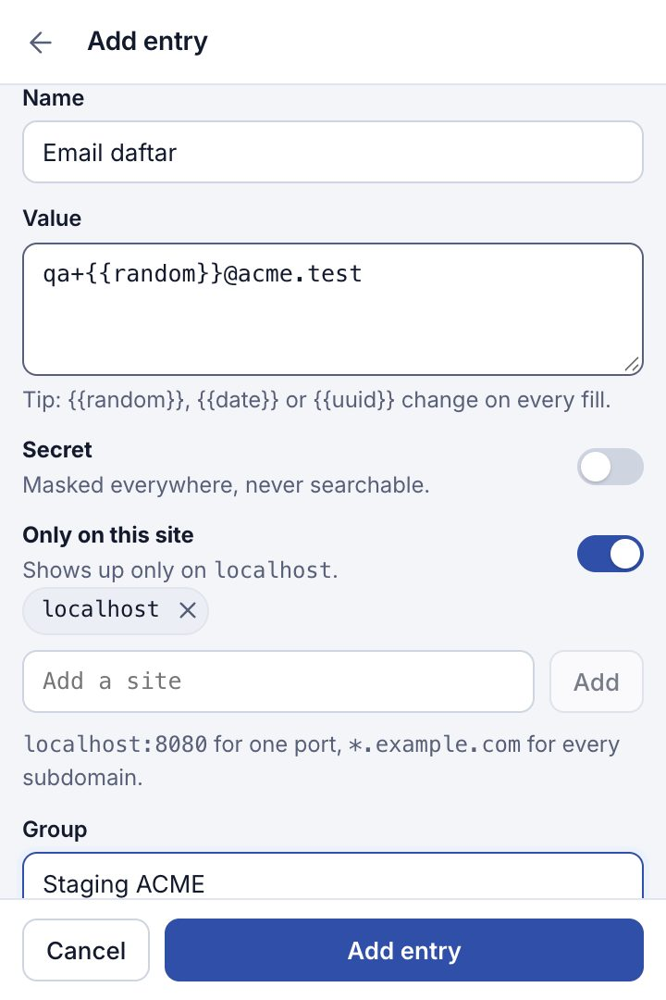

**Dynamic values.** Put these in a value and Tuckfill replaces them every time it fills:

| Write | Becomes |
|---|---|
| `{{random}}` | 6 random digits, e.g. 481920 |
| `{{date}}` | today's date, e.g. 2026-11-06 |
| `{{time}}` | the time, e.g. 14:05 |
| `{{uuid}}` | a long unique ID |

In the screenshot, `qa+{{random}}@acme.test` gives a fresh email for every sign-up.

## 3. Turn on for a site

Tuckfill only runs on sites you choose.

1. Open the site you want to fill.
2. Click the Tuckfill icon and flip the switch at the top (**Show the in-field button here**).
3. Chrome asks for access to **that site only**. Click **Allow**.

To turn it off, flip the same switch. All sites you've turned on are listed under Settings → **Sites**.

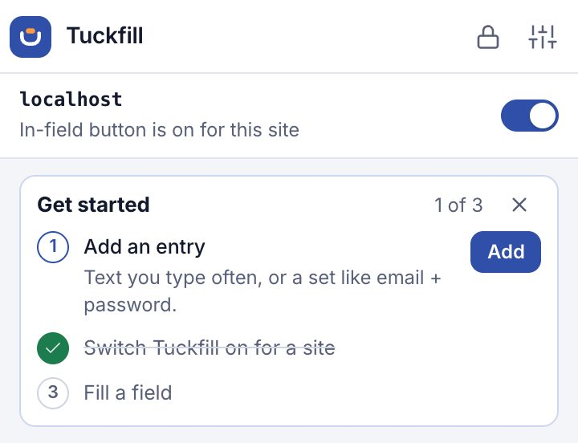

## 4. Fill a field

1. Click a field on that site. A small blue button appears inside it.
2. Click the button and pick an entry. You can also type to search and press <kbd>Enter</kbd>.
3. The value goes into the field. Tuckfill **never** submits the form, so you can check first. Picked the wrong one? Click **Undo**.

| ① The button inside the field | ② Pick an entry | ③ Filled, with a fresh random number |
|---|---|---|
| 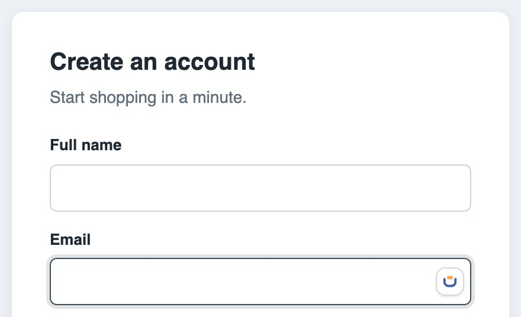 | 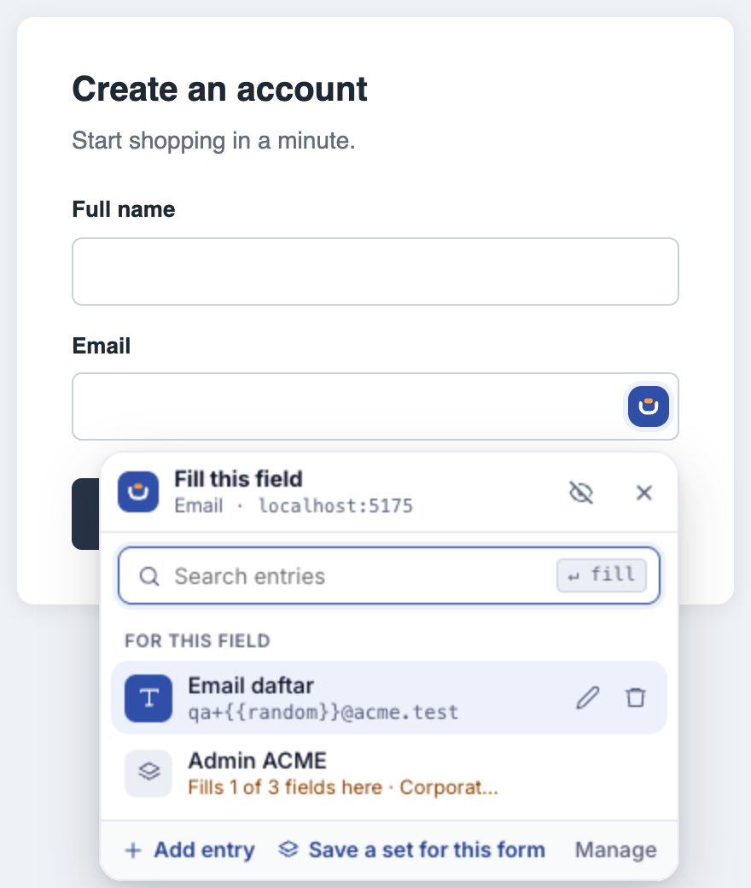 | 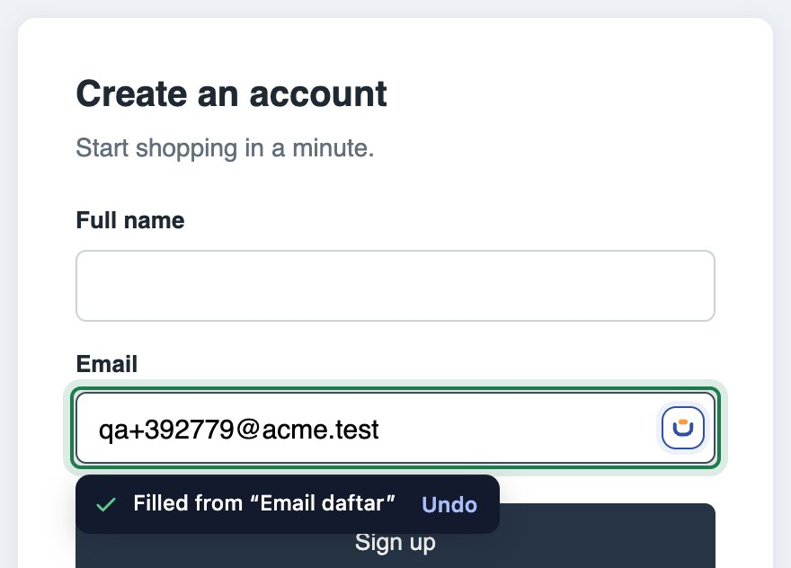 |

Keyboard shortcut: click a field, then press <kbd>Alt</kbd>+<kbd>Shift</kbd>+<kbd>F</kbd> (Mac: <kbd>⌥ Option</kbd>+<kbd>Shift</kbd>+<kbd>F</kbd>). In the picker, use <kbd>↑</kbd> <kbd>↓</kbd> and <kbd>Enter</kbd>; <kbd>Esc</kbd> closes it.

## 5. Sets: fill several fields at once

For a test account made of several values, e.g. Corporate ID + User ID + Password, create a **set**:

1. Click **Add entry** and choose **Set of fields**.
2. Name each field **like its label on the form** ("Email", "User ID", "Phone", "Password"), then fill in its value.
3. Mark the password as **Secret**.

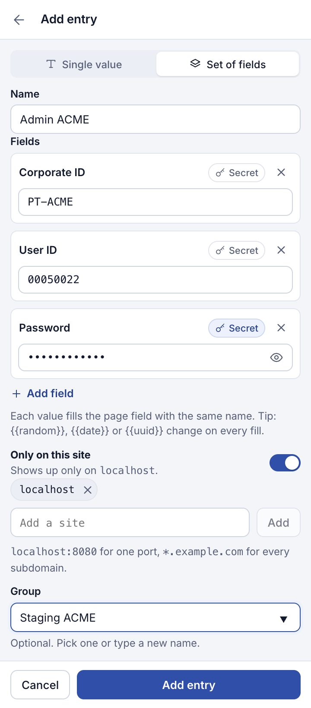

Click **any** field on that form and pick the set. Each value goes into the field whose name matches.

| Click any field, pick the set | Three fields filled at once |
|---|---|
|  | 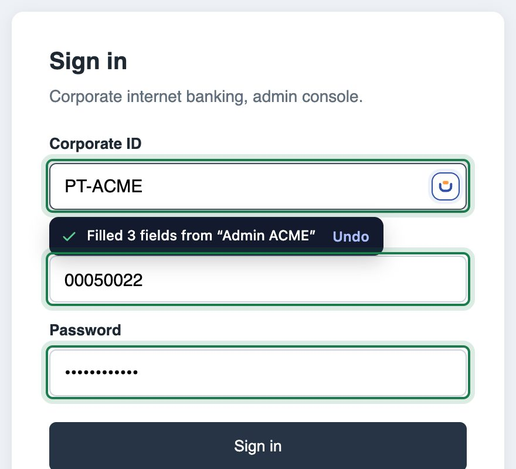 |

- Values without a matching field are **skipped**, never guessed. The toast tells you, e.g. "Filled 2 of 3, 1 not found".
- A password only ever goes into a password box.
- One **Undo** restores every field.
- Within a set, every `{{random}}` uses the same number.

## 6. Touch ID, auto-lock & backup

All of this lives in **Settings** (the sliders icon at the top right of the popup).

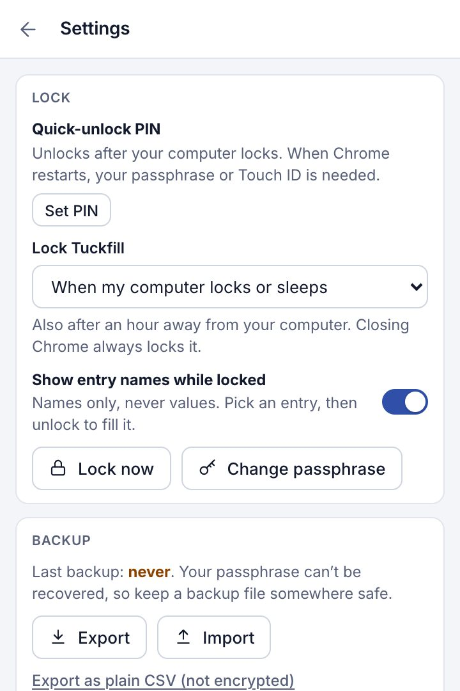

**Touch ID / Windows Hello.** Settings → Lock → **Unlock with Touch ID**, or accept the offer after you type your passphrase. Save the passkey to **iCloud Keychain** or **Google Password Manager**, not "This Chrome profile". Tuckfill still asks for your passphrase every 2 weeks so you don't forget it. Inside web pages, Touch ID works on https sites only.

**Auto-lock.** Tuckfill locks itself after a period of inactivity (15 minutes by default) and when Chrome closes.

**Backup.**
- **Export** saves an encrypted `.tuckfill` file that opens with the same passphrase. Do it regularly: it's your only copy if your laptop dies or you forget the passphrase.
- **Import** merges a `.tuckfill` or `.csv` file without deleting any existing entries.
- On a new laptop, choose **Restore from a backup** during setup.
- A plain CSV export exists too, but that file is **not encrypted**.

## 7. Report a bug

1. Open Settings, scroll to **About**, and click **Copy**. This copies your Tuckfill, Chrome and OS versions, **without** any entries or sites.
2. Send it in chat, or open an **Issue** in this repo, using this format:

| | |
|---|---|
| **Details** | what you copied from About |
| **Site** | the address of the form page |
| **Steps** | what you did |
| **Expected** | what should have happened |
| **Actual** | what happened |
| **Screenshot** | of the form, for filling problems |

> [!CAUTION]
> Never send passwords, entry contents, or screenshots of the popup showing your entries.

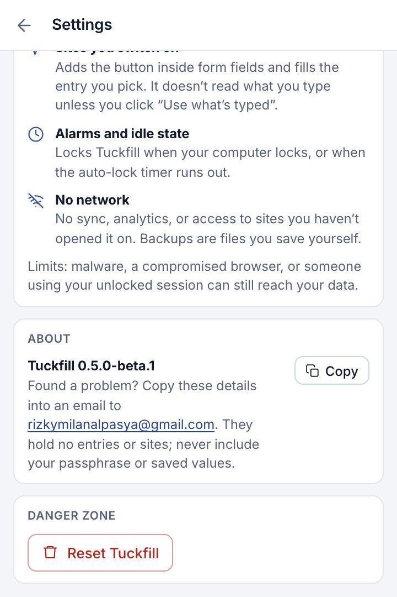

## Limits & FAQ

- Up to **1,000 entries** (about 3 MB). A value can be up to 5,000 characters, an entry name 60 characters, and a set has 2–12 fields. Import files up to 5 MB.
- Not yet supported: dropdowns, checkboxes, radio buttons, and fields inside iframes from other sites.
- Whatever you fill is visible to that site (that's the point), so only fill on sites you trust.

**The button doesn't show up in a field?**
Check that the site switch in the popup is on. Tuckfill only runs on regular http/https pages, not on `chrome://` pages or the Chrome Web Store.

**My entries disappeared after an update?**
They shouldn't: Tuckfill keeps the same ID whatever folder it's in. Make sure the old version is *removed* (never have two Tuckfills installed), then open the popup again. If it's still empty, restore from a backup and report it.

**Forgot your passphrase?**
It can't be recovered. Choose "Forgot passphrase?" to reset (all entries are deleted), then restore from a backup if you have one.

---

Screenshots use a demo site and fake data, captured automatically from the Tuckfill build (`npm run guide:shots` in the code repo).
